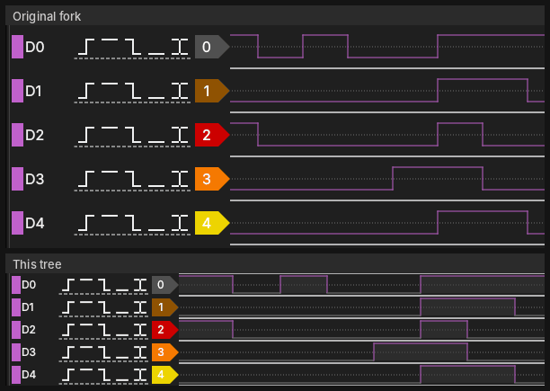
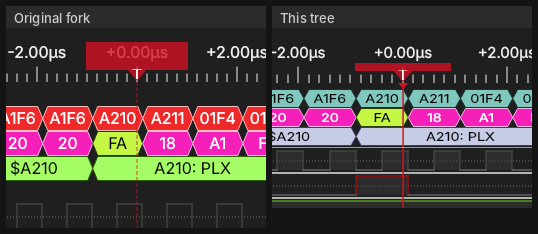
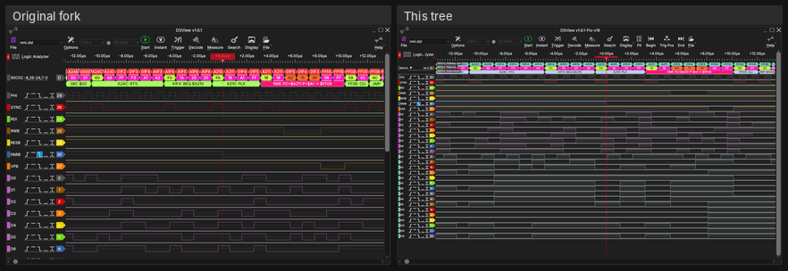
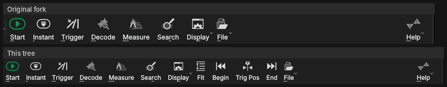
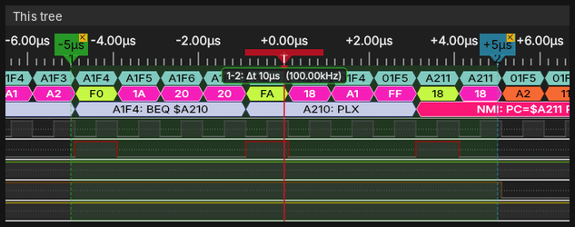
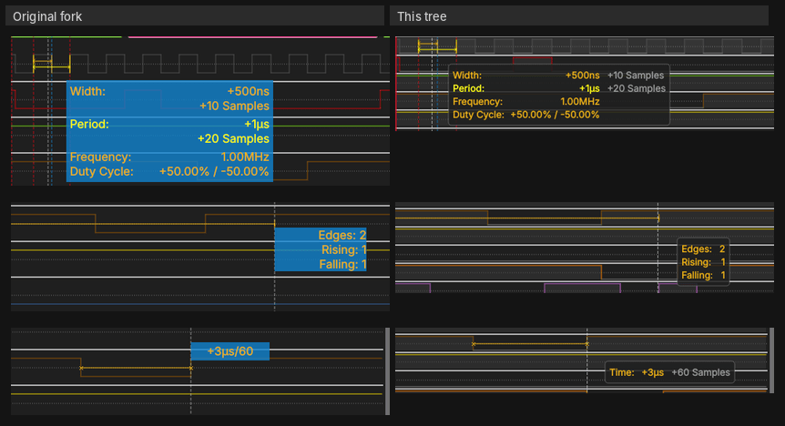
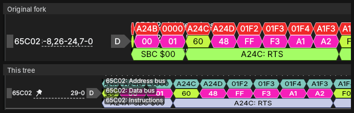
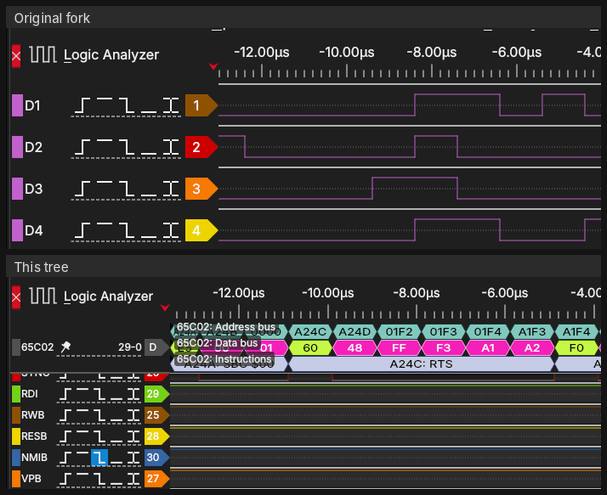
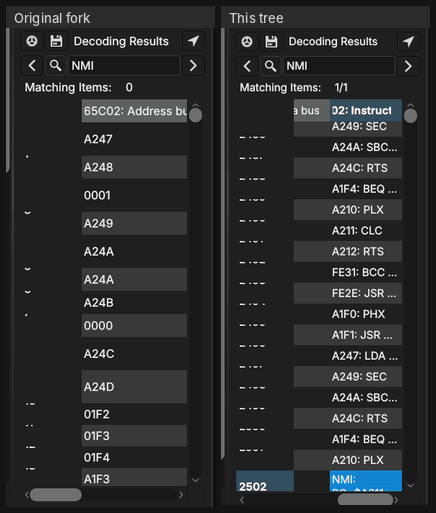

# Changelog: DSView 1.6.1 (Schildkroet fork), modified

This file lists every change in this tree compared with the fork it came from:
[Schildkroet/DSView](https://github.com/Schildkroet/DSView), `master` at commit
`2341d8f` (19 Nov 2026). On 20 Nov 2026 that commit was still the latest one on the
fork.

Unless stated otherwise:

- settings are under **Display → Options**;
- every new setting is remembered between sessions;
- all new UI text has English, German and Chinese translations.

The pictures compare the original fork with this tree on the same capture, a
65C02 bus sampled at 20 MHz. The fork has no 65C02 decoder, so for these
pictures it was added to the fork's build.

---

## Logic trace display

### Logic trace colors (new settings group)
- **High level color** and **Low level color**: draw the high and low parts of
  logic traces in their own colours, as PulseView does. Each level has its own
  switch and colour picker. A level that is switched off keeps the channel
  colour, so you can colour just one of them. Builds that had a single switch
  for both levels pass that setting on to both new switches.
- **Fill high areas**: shades the area under high pulses. The fill colour has
  an alpha channel, so it can be transparent.
- **Reset colors**: restores the default colours.
- Picking a colour also switches that colour on. Swatches always show their
  colour, even while switched off.
- **Bus channels in decoder colors**: channels that a decoder groups into a bus
  take the colour of that bus's decoded data. For example, A0–A15 take the
  colour of the 65C02 "Address bus" row. This covers the colour strip before
  the name and the waveform edges. The numbered box keeps the probe wire
  colour. Only decoders that declare channel groups are affected (see
  [Display hints for decoder authors](#display-hints-for-decoder-authors)).

### Waveform view (new settings group)
- **Show sample points when zoomed in**: logic traces now show a dot at every
  sample once zoomed in far enough. The same switch also controls the dots the
  oscilloscope already drew.
- **Vertical line at mouse position**: the dashed guide line that follows the
  mouse over all traces can now be switched off. It is on by default, as before.
- **Highlight channel under mouse**: shades the row under the pointer.
- **Time between cursors (1-2, 3-4, ...)**: each cursor pair gets a shaded band
  and a label with Δt and the matching frequency.
- **Highlight trigger position**: draws the trigger position as a solid red line
  with a flag.
- The trigger marker on the time ruler (the red box with the "T") is now a thin
  band under the time labels; it used to cover the label at the trigger. That
  label now always reads "+0.00", where it sometimes said "-0.00".

### Fit: shrink all channels into the window
- New **Fit** button on the toolbar, logic mode only. It is also in the
  **Display** menu as "Shrink all channels to fit the window", for narrow
  windows where the toolbar moves the button out of sight.
- It picks the largest vertical zoom, never above normal size, at which every
  enabled channel and decoder fits without scrolling.
- Below normal size, the gaps between channels shrink first, then the rows.
  Channel names and decoded values keep full size while the rows have room for
  them, then shrink. Below 6 pt they are hidden rather than overlapping.
- The vertical zoom now goes down to 0.15 of normal size (it stopped at 0.5),
  and below normal size the rows really get smaller. Before, the minimum row
  height held them at full size.

### Begin, Trig Pos, End: jump through the capture
- Three new toolbar buttons after **Fit**, logic mode only. They move the view
  and keep the zoom:
  - **Begin**: the first sample at the left edge.
  - **Trig Pos**: the trigger position in the middle of the view. This is the
    0 of the time ruler, where the trigger flag is drawn. Without a trigger it
    is the first sample, so the view goes to the beginning.
  - **End**: the last captured sample at the right edge. If a capture was
    stopped early, or is still running, that is the last sample received.
- In a narrow window they move into the toolbar's overflow (») with Fit, and
  work from there too.

### Cursors
- Cursor labels that would overlap are drawn compact (number only). The label
  under the mouse, or the one being dragged, expands on top of the others.
- Labels are sized from the text actually shown; relative times used to be
  clipped.

### Measurement
- The hover measurement box is a compact, see-through table that stays inside
  the view instead of being cut off at the edges.
- **Enable floating measurement** (Measure panel) now also hides the
  width/period brackets drawn on the channels, not only the value box. It is
  remembered between sessions. The panel's own values still update.
- The manual measurements use the same box as the hover measurement: counting
  edges (click on a channel, then move along it) shows Edges, Rising and
  Falling in columns, and edge to edge (click on an edge, then move to another)
  shows the time and, dimmed, the samples, as in "Time: +3µs +60 Samples".
  They used to be flat blue boxes in another font, which could be cut off at
  the edge of the view.

### Units
- Frequencies show "kHz" instead of "KHz".
- Hold-off times show µs/ms/s instead of uS/mS/S (S is siemens). "DBV" is now
  "dBV" in all languages.

---

## Protocol decoders

### Decoded data on the waveform
- Values that don't fit their space are shortened with "…" instead of being cut
  off ("6F" used to show as "6"). Hovering shows the full text.
- Row names ("Address bus", "Data bus", …) are drawn on top of the decoded data
  in a see-through box. Before, the data covered them.
- The channel list next to a decoder's name shows compact ranges, highest first
  (e.g. `31,28-0`). If those don't fit, it shows a count (e.g. `30 ch`). The old
  code garbled the list for decoders with many channels, e.g.
  `,15-0,1515-1515`, and ran it into the decoder name.

### Copy a decoded value
- Right-click a decoded value (logic mode) and choose **Copy annotation text**
  or **Copy with row name**.
- When zoomed out, the click picks the annotation you can actually see. Before,
  it could pick a start or stop bit only a pixel or two wide.
- A right-drag of 2 px or less now counts as a click, not a zoom.

### Pin decoders on top
- Right-click a decoder in the channel list and choose **Pin to top** or
  **Unpin**.
- Pinned decoders are laid out first. They stay at the top while the other
  channels scroll under them, with a divider and a shadow at the edge.
- A pin icon follows the decoder name. Mouse actions in the pinned area reach
  only the pinned decoders.
- The pinned state is saved in session files.

### Export of decoded data
- **Separator**: comma, semicolon, tab, pipe or space. The choice is
  remembered.
- Fields are quoted following RFC 4180, so text containing the separator,
  quotes or line breaks stays in one column.
- **Only between cursors**: exports just the part between two cursors. It needs
  at least two cursors on the waveform.

### Decoder search
- The search box in the Decoders panel also matches each decoder's long name.
  For example, "6502" finds the 65C02 decoder.

### Search in the decoding results
- The search box above the decoding results list searches every column of the
  list. It used to search only the column that was clicked last, which is the
  first one ("Address bus" for the 65C02) until you click another. So "NMI"
  found nothing unless you had clicked a cell in the Instructions column first.
- Matches are visited in time order across all columns. The list scrolls to the
  matching cell, also sideways, and the waveform jumps to it. As before, the
  search starts from the cell you selected last.
- **Enter** in the search box finds the next match, like the next button.
- Upper and lower case are treated the same: "nmi" finds "NMI".
- "Matching Items" shows the position of the selected match, e.g. "3/12".
- Text containing a dash, such as "->" or "RESET -> $E000", no longer freezes
  DSView. Before, any dash started a multi-byte search ("70-70-70"), and in a
  column without numbers that search never finished. A dash now starts a
  multi-byte search only when there is a value on both sides of every dash, and
  the text is always searched as typed as well.
- The navigate button picks the right row while a search is active. It used to
  look up the row among the search results instead of in the whole list.
- The search no longer changes widgets from a worker thread.

### New decoder: 65C02 (WDC W65C02S / 6502 CPU bus)
This decoder is not part of the upstream fork.

**What it decodes**

- It rebuilds one bus cycle per PHI2 period and disassembles the program, using
  SYNC to find instruction boundaries.
- Rows: Address bus, Data bus (opcode fetches, reads and writes), Instructions
  (with reset and interrupt events) and Warnings.

**Channels**

- Required: D0–D7, PHI2, RWB and SYNC.
- Optional: A0–A15, VPB, RESB and RDY. With A0–A15 the disassembly shows
  instruction addresses and absolute branch targets.

**Opcodes and timing**

- It uses the W65C02S opcode table, including RMB, SMB, BBR, BBS, WAI and STP.
  Documented NMOS 6502 code decodes correctly; NMOS "illegal" opcodes don't.
- **Sample point before PHI2 falling edge (ns)**: default 30.

**How it shows up**

- Its label is always "65C02", whatever a session file says, so the channel
  list stays narrow.
- It is pinned on top by default.
- The Address bus row is #80c8bd and the Instructions row is #c6cbe6. A0–A15
  take the address colour and D0–D7 the data-read colour.

### Display hints for decoder authors
Decoders can set these optional class attributes in `pd.py`. Other sigrok
front ends ignore them. A malformed hint is ignored with a warning in the log;
it never stops the decoder from loading.

| Attribute | Example | Effect |
|---|---|---|
| `pin_on_top` | `pin_on_top = True` | The decoder is pinned on top when added, and when a session file doesn't record its pinned state. |
| `fixed_label` | `fixed_label = True` | The decoder is always labelled with its `name`. Labels in session files are ignored and it can't be renamed in the channel list. |
| `channel_colours` | `(('a', 'addr'), ('d', 'read'))` | Channels whose id is the prefix followed by digits (`a0`…`a15`) take the colour of that annotation class. Needs **Bus channels in decoder colors** to be on. |
| `annotation_colours` | `(('addr', '#80c8bd'),)` | A fixed colour for an annotation class. If the user picks a colour for the decoder trace, that colour wins. |

### Other decoders
Identical to the fork's versions, apart from typo fixes in their display
strings: tranceiver, patters, Protcol, Hight, Adress, Channnel.

---

## Session files
- Decoders on their default colour were saved as `#000000` and reopened black.
  They are now saved as `default`, and `#000000` from older files is read as the
  default colour.
- A logic capture opened from a file now always shows its trigger: the T marker
  and trigger line, with the time ruler counting from the trigger. Before, the
  file reader sent the trigger position without setting its "triggered" flag,
  leaving that byte to whatever was in memory, and DSView ignored the position
  whenever it read 0. Whether it worked depended on the build, and could change
  from one build to the next. The Trig Pos button and the ruler now always use
  the position saved in the file.

---

## Text and translations
- Spelling fixed throughout the UI: Substract, suppport, setted, fullfill,
  scoll, defualt, 2st, Tig. A broken fallback string ("Decoder
  s_ann_search_editearch...") is also fixed.
- Grammar fixed in confirmation and error messages. Examples: "Are you sure you
  want to remove this decoder?", "Don't Show Again", "Data out of range",
  "Unexpected error!".
- Settings labels reworded, e.g. "Show trigger position in the middle" and
  "Delete Group".
- Translation entries added where they were missing: "Signal line width",
  "Channel divider line" and the scope's "Split" button.
- The fallback strings in the code now match the language files.

---

## Version and installation
- The window title, the About dialog and `DSView --version` show this tree's
  fix revision, e.g. "DSView v1.6.1-Fix-v16". It is `DS_FIX_REVISION` in
  CMakeLists.txt: raise it with every release of the tree.
- The About dialog shows where this tree comes from, with links: forked from
  [mrehkopf/DSView](https://github.com/mrehkopf/DSView), fork by Schildkroet
  ([Schildkroet/DSView](https://github.com/Schildkroet/DSView)), re-forked by
  lucapandolfini ([lucapandolfini/DSView](https://github.com/lucapandolfini/DSView)).
  It used to name only the Schildkroet fork. README.md opens with the same
  history and points to this file.
- `sudo make uninstall` removes what `make install` put on the system: the
  files listed in build/install_manifest.txt, the Python caches DSView leaves
  in its decoder folder, and the DSView folders once empty. Anything it did not
  install is kept and listed. Files it cannot remove, as without sudo, are
  reported, with the hint to use sudo. `sudo make purge` also deletes the
  DSView settings. In the build folder it is `make uninstall`, or
  `cmake --build build --target uninstall`. See INSTALL.
- `make deb` builds a package now: it stopped with an error, as CPack requires
  a package maintainer and none was set.
  The package is `dsview`, versioned `1.6.1+fix<n>` so each release of the tree
  upgrades the previous one, installs under /usr, and lists the libraries it
  needs (found by dpkg-shlibdeps, from dpkg-dev; before, only the Qt platform
  plugins were listed). Removing it also clears the Python caches that running
  DSView as root leaves in the decoder folder, which used to keep that folder
  behind. `make deb` warns if DSView uses libraries from /usr/local, which a
  package cannot depend on, and if a `make install` copy in /usr/local would be
  started instead of the package. `make uninstall` keeps the files that also
  belong to the installed package (desktop entry, metainfo, udev rule).
